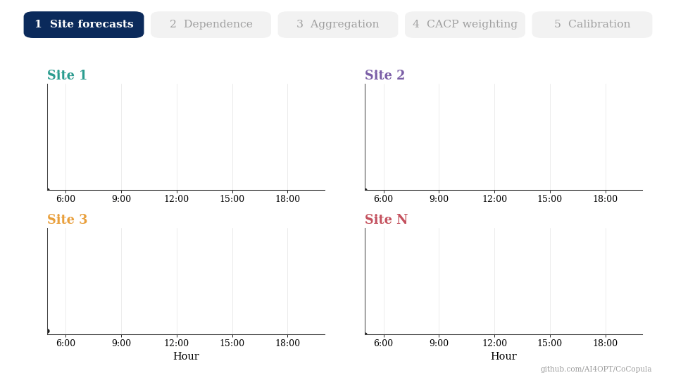

<div align="center">

# CoCopula

### Conformal Calibration and Copula Aggregation for Reliable Renewable Energy Forecasting

**Alireza Moradi · Mathieu Tanneau · Reza Zandehshahvar · Pascal Van Hentenryck**

NSF AI Institute for Advances in Optimization (AI4OPT), Georgia Institute of Technology


</div>

---

## Overview

System operators often receive **probabilistic forecasts for individual sites** (solar or wind
farms) but have **no forecasting model for the fleet as a whole**. CoCopula builds a reliable
fleet-level forecast from the site-level forecasts alone, in two stages:

<p align="center">
  
</p>

1. **Aggregation.** A Gaussian copula captures the dependence between the forecast errors of the
   sites. Monte Carlo samples from the copula are mapped through each site's predictive
   distribution and summed, giving a predictive distribution for the total fleet generation.
2. **Calibration.** Context-Aware Conformal Prediction (CACP) corrects the aggregated
   intervals using past forecast errors, weighting each past hour by how similar its context
   (solar position, time of day/year, previous-day generation) is to the hour being forecast.

## Repository structure

```
CoCopula/
├── cocopula/                 the method
│   ├── data.py               loading the arrays and the context features
│   ├── copula.py             PIT values, Gaussian-copula fit, Monte Carlo aggregation
│   ├── conformal.py          CQR and CACP calibration
│   ├── metrics.py            PICP, AIW and Winkler score
│   └── pipeline.py           the two stages over a year of data
├── scripts/
│   ├── download_data.py      download the PERFORM data and build the arrays
│   └── run.py                run one method: aggregation -> calibration -> metrics
├── covariates/               context features of CACP (not part of the NREL data)
├── sites/                    site order used in the paper, one list per ISO
├── figures/                  overview animation of the README
├── requirements.txt
└── LICENSE
```

## Installation

```bash
git clone https://github.com/AI4OPT/CoCopula.git
cd CoCopula
pip install -r requirements.txt        # numpy, scipy, pandas, scikit-learn, h5py
```

## Data

**Source.** NREL / ARPA-E **PERFORM** dataset ([documentation](https://github.com/PERFORM-Forecasts/documentation),
[AWS Open Data](https://registry.opendata.aws/arpa-e-perform/)): day-ahead solar forecasts and actuals for
MISO and SPP (2019) and ERCOT (2018). The data is public; no account is needed.

**Download.** One command per ISO downloads the raw files and builds the arrays used by the code:

```bash
python scripts/download_data.py --iso MISO  --data_dir DATA_DIR   # ~6 GB
python scripts/download_data.py --iso SPP   --data_dir DATA_DIR   # ~1.5 GB
python scripts/download_data.py --iso ERCOT --data_dir DATA_DIR   # ~1.9 GB
```

This writes `DATA_DIR/<ISO>/{site_actuals, site_quantiles, fleet_actuals, fleet_quantiles_nrel, fleet_capacity}.npy`
(raw files are cached in `DATA_DIR/raw/`).
Running MISO needs about 6 GB of memory (its site forecasts are 5.2 GB).

**Included in this repository.** `covariates/` holds the CACP context features (not part of PERFORM) and
`sites/` the site order used in the paper.

## Usage

One command runs a method on one ISO: it aggregates the site forecasts (if the method needs it),
calibrates the fleet forecast (if `--calibration` is given), and reports the metrics.

```bash
python scripts/run.py --data_dir DATA_DIR --iso MISO --aggregation copula --calibration cacp --out_dir out/
```

| Method | `--aggregation` | `--calibration` |
|---|---|---|
| NREL † | `nrel` | – |
| NREL+CQR † | `nrel` | `cqr` |
| NREL+CACP † | `nrel` | `cacp` |
| Ind | `independent` | – |
| Copula | `copula` | – |
| Copula+CQR | `copula` | `cqr` |
| **CoCopula** | `copula` | `cacp` |

– : leave the argument out. † NREL's own fleet-level forecast, a reference that is not available in
the setting studied. `--iso` is `MISO`, `SPP` or `ERCOT`.

The command prints PICP, AIW and Winkler score at the 90%, 80%, 70% and 60% levels and saves
`out/<iso>_<aggregation>[_<calibration>]_{quantiles,times,metrics}` (calibrated quantiles of every
test hour, their time stamps, and the metrics). The aggregated fleet forecast is saved as
`out/<iso>_<aggregation>.npy` and reused by later runs, so the copula is fitted only once per ISO.

## Experimental protocol

* **Normalization.** Generation and forecasts are divided by the fleet capacity; hours with zero
  generation (night) are excluded.
* **Aggregation.** Σ is first fitted on January–June (used for January–July) and refitted at the
  start of every later month on all earlier data. PIT values use piecewise-linear CDFs through the
  99 quantiles, clipped to [10⁻⁴, 0.999]; 1000 Monte Carlo samples.
* **Calibration.** July–December is split into consecutive 7-day test windows. For each window,
  the preceding 7 days form the validation set and all earlier hours the calibration set.
  CACP selects its kernel (RBF or Laplacian) and bandwidth γ ∈ {0.5, 1, 2} on the validation week
  by the lowest mean Winkler score; the calibrator is then refitted on calibration + validation
  data and applied to the test window.
* **Metrics.** PICP, AIW and Winkler score are computed within each test window and averaged over
  the windows.

## Citation

If you use this code, please cite:

```bibtex
@article{moradi2026copula,
  title={Copula-based aggregation and context-aware conformal prediction for reliable renewable energy forecasting},
  author={Moradi, Alireza and Tanneau, Mathieu and Zandehshahvar, Reza and Van Hentenryck, Pascal},
  journal={arXiv preprint arXiv:2602.02583},
  year={2026}
}
```

## License

Released under the [MIT License](LICENSE).
